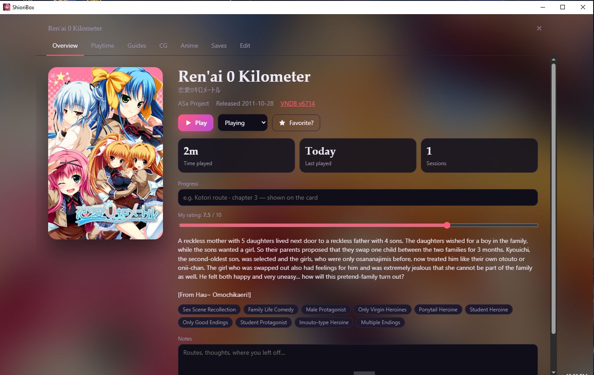
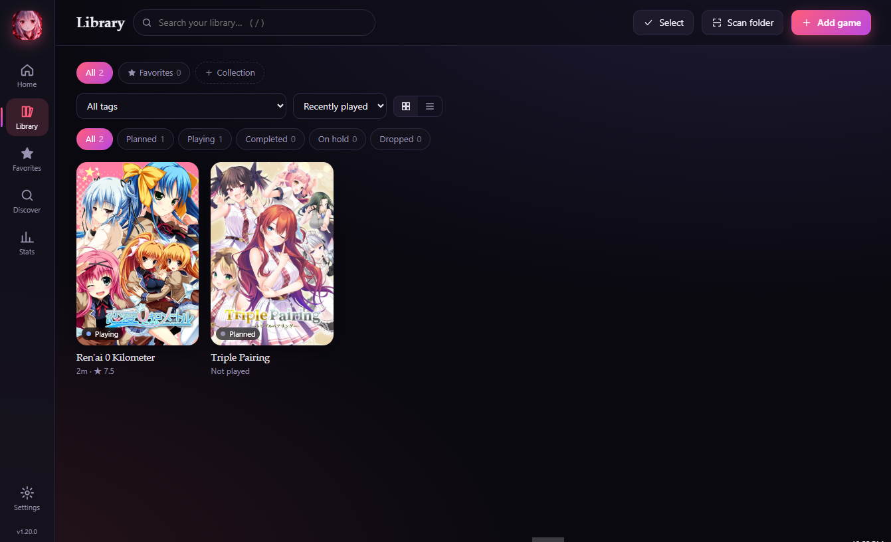
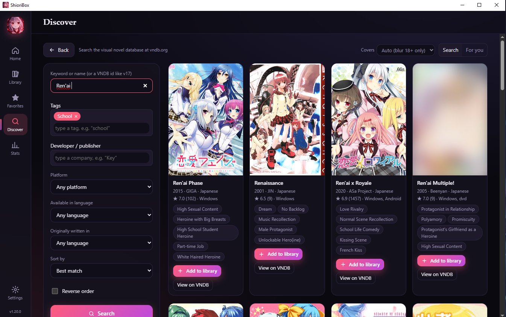
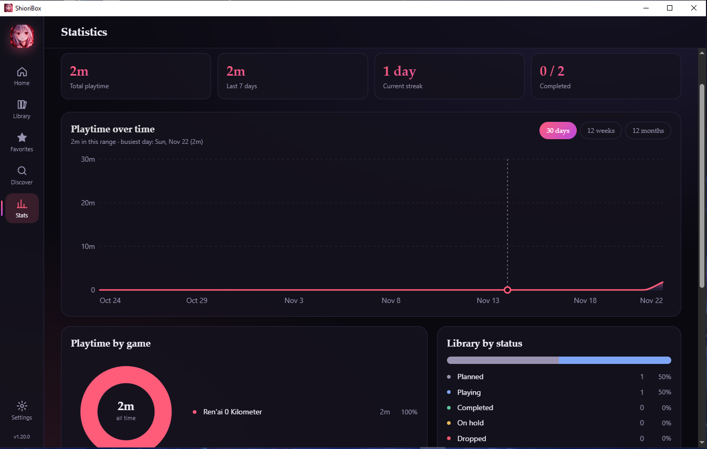

# ShioriBox

<p align="center">
  
</p>

<p align="center">
  <strong>A desktop library for organizing, discovering, and launching visual novels on Windows.</strong>
</p>

<p align="center">
  <a href="#features">Features</a> ·
  <a href="#screenshots">Screenshots</a> ·
  <a href="#getting-started">Getting started</a> ·
  <a href="#building-from-source">Build from source</a> ·
  <a href="#data-and-backups">Data & backups</a>
</p>

ShioriBox brings your visual novel collection, play sessions, metadata, guides, and library tools together in one desktop app. It is built with Go and a bundled web interface, and uses WebView2 for its native Windows window.

## Features

- **Personal library** — keep track of titles, covers, developers, release dates, ratings, tags, categories, favourites, notes, and play status.
- **Metadata and discovery** — look up visual novels and explore titles using the app's discovery tools.
- **Game launching and playtime** — launch games from your library, pass launch arguments, and track play sessions.
- **CG gallery** — browse available CG artwork from supported sources.
- **Guides and notes** — keep walkthroughs and useful information alongside each title.
- **Japanese locale support** — launch games with the bundled Shiori Locale engine, Locale Emulator, or a custom launcher.
- **Library maintenance** — scan folders for games, import and export your library, and create or restore snapshots.
- **Personalization** — dark and light themes, custom backgrounds, and adjustable interface appearance.
- **Privacy controls** — optional cover blurring and a configurable quick privacy screen.

## Screenshots

<p align="center">
  <strong>Overview</strong><br>
  
</p>

<p align="center">
  <strong>Library</strong><br>
  
</p>

<p align="center">
  <strong>Discover</strong><br>
  
</p>

<p align="center">
  <strong>Add games</strong><br>
  
</p>

<p align="center">
  <strong>Statistics</strong><br>
  
</p>

## Getting started

1. Open the [Releases](https://github.com/frost662/Shioribox/releases) page.
2. Download the latest **ShioriBox-Setup** installer.
3. Run the installer and follow the prompts.
4. Launch ShioriBox and add your visual novels to the library.

ShioriBox uses the Microsoft Edge **WebView2 Runtime** for its native window. It is included with Windows 11 and many up-to-date Windows 10 installations. If it is missing, install the free [Evergreen WebView2 Runtime](https://developer.microsoft.com/microsoft-edge/webview2/).

> **Note:** This repository may contain source updates newer than the latest published installer. Check the release notes when choosing a download.

## Building from source

### Requirements

- Windows 10 or later (64-bit)
- [Go 1.22 or newer](https://go.dev/dl/)
- Microsoft Edge WebView2 Runtime to run the native Windows window
- Git (recommended)

### Build

Open PowerShell in the repository root:

```powershell
cd source/shioribox-app
go test ./...
go build -ldflags="-H windowsgui" -o ../../ShioriBox.exe .
```

The executable will be created as `ShioriBox.exe` in the repository root. The application embeds its web interface and locale-engine files at build time.

### Build the Windows installers

1. Build `ShioriBox.exe` using the command above.
2. Install [Inno Setup 6.3 or newer](https://jrsoftware.org/isinfo.php).
3. Make sure the repository's `README.txt` file is present beside the executable (if you are packaging a release).
4. Run `installer/build-installer.bat`.
5. Find the setup and update installers in `installer/output/`.

The setup installer is for new installations. The update installer is intended for an existing ShioriBox installation and is designed to preserve its library.

## Data and backups

ShioriBox keeps its library and settings outside the embedded application resources:

- By default, it tries to use a `data` folder beside the executable.
- If that location is not writable, it uses the user's configuration directory under `ShioriBox`.
- You can override the location with the `SHIORIBOX_DATA` environment variable or the `-data` command-line option.

Use the built-in snapshot and library export features before moving installations or making major changes. The installer is designed not to overwrite your library during an update.

## Project layout

```text
.
├── assets/                  # Repository logo and screenshots
├── installer/               # Inno Setup installer and build script
├── source/
│   └── shioribox-app/
│       ├── engine/          # Bundled locale-engine files
│       ├── web/             # Embedded HTML, CSS, and JavaScript interface
│       ├── *_test.go        # Go tests
│       ├── go.mod
│       └── main.go
├── LICENSE
└── README.md
```

## Contributing

Bug reports, reproducible issues, and focused pull requests are welcome. Please include your Windows version, ShioriBox version, steps to reproduce, and relevant log details when reporting a problem. Do not include personal library data or private game files in an issue.

## License

ShioriBox is distributed under the [MIT License](LICENSE). Third-party components retain their own licenses; see the relevant notices in the source tree, including `source/shioribox-app/web/hls.LICENSE.txt`.
